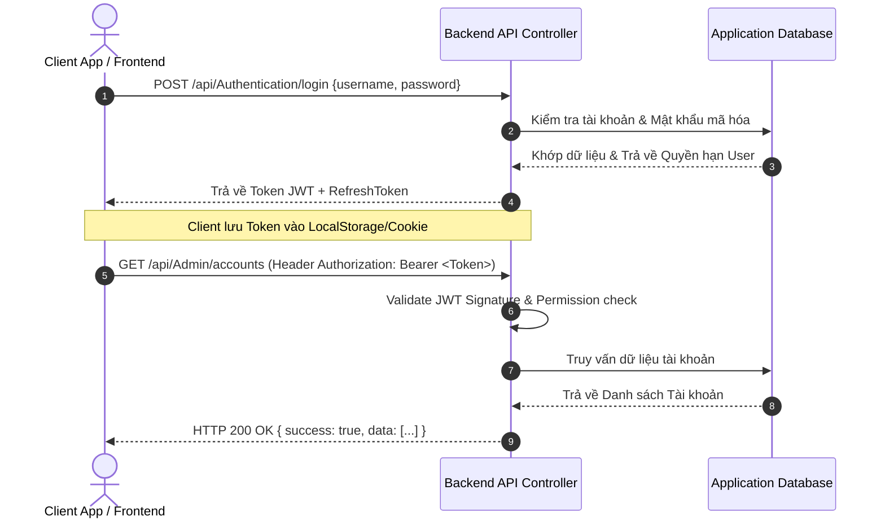

# TÀI LIỆU API HỆ THỐNG MECHANICAL SUPPLIES STORE
> **Dự án**: Mechanical Supplies Store (Hệ thống Bán hàng & Dịch vụ Thiết bị Cơ khí)  
> **Trạng thái**: Production / Active  
> **Phiên bản API**: `v1.0.0`  
> **Đơn vị vận hành**: Antigravity Technical Team  

---

## MỤC LỤC TỰ ĐỘNG (TABLE OF CONTENTS)
- [1. PHẦN A – TỔNG QUAN HỆ THỐNG](#1-phần-a--tổng-quan-hệ-thống)
  - [1.1 Giới thiệu](#11-giới-thiệu)
  - [1.2 Thông tin kỹ thuật chung](#12-thông-tin-kỹ-thuật-chung)
  - [1.3 Lịch sử thay đổi (Changelog)](#13-lịch-sử-thay-đổi-changelog)
  - [1.4 Thuật ngữ & Viết tắt](#14-thuật-ngữ--viết-tắt)
- [2. PHẦN B – BẮT ĐẦU NHANH & QUY ƯỚC CHUNG](#2-phần-b--bắt-đầu-nhanh--quy-ước-chung)
  - [2.1 Xác thực & Phân quyền (JWT Bearer Token)](#21-xác-thực--phân-quyền-jwt-bearer-token)
  - [2.2 Cấu trúc Response chuẩn (ApiResponse Wrapper)](#22-cấu-trúc-response-chuẩn-apiresponse-wrapper)
  - [2.3 Quy ước chung & Phân trang](#23-quy-ước-chung--phân-trang)
  - [2.4 Hướng dẫn cURL chạy thử API đầu tiên](#24-hướng-dẫn-curl-chạy-thử-api-đầu-tiên)
- [3. PHẦN C – CHI TIẾT TỪNG API THỰC TẾ](#3-phần-c--chi-tiết-từng-api-thực-tế)
  - [3.1 Nhóm API Xác thực & Tài khoản (`/api/Authentication`, `/api/Admin`)](#31-nhóm-api-xác-thực--tài-khoản-apiauthentication-apiadmin)
  - [3.2 Nhóm API Danh mục (`/api/Categories`)](#32-nhóm-api-danh-mục-apicategories)
  - [3.3 Nhóm API Sản phẩm (`/api/Products`)](#33-nhóm-api-sản-phẩm-apiproducts)
  - [3.4 Nhóm API Bài viết, Dịch vụ & Tin tức (`/api/Posts`)](#34-nhóm-api-bài-viết-dịch-vụ--tin-tức-apiposts)
  - [3.5 Nhóm API Đối tác & Khu vực (`/api/Partners`)](#35-nhóm-api-đối-tác--khu-vực-apipartners)
  - [3.6 Nhóm API Yêu cầu Liên hệ (`/api/Contacts`)](#36-nhóm-api-yêu-cầu-liên-hệ-apicontacts)
  - [3.7 Nhóm API File & Hình ảnh (`/api/Files`)](#37-nhóm-api-file--hình-ảnh-apifiles)
  - [3.8 Nhóm API Thống kê Dashboard (`/api/admin/dashboard`)](#38-nhóm-api-thống-kê-dashboard-apiadmindashboard)
  - [3.9 Nhóm API Vai trò & Quyền hạn (`/api/Roles`)](#39-nhóm-api-vai-trò--quyền-hạn-apiroles)
  - [3.10 Nhóm API Nhật ký Hệ thống (`/api/Logs`)](#310-nhóm-api-nhật-ký-hệ-thống-apilogs)
- [4. PHẦN D – THAM CHIẾU & PHỤ LỤC](#4-phần-d--tham-chiếu--phụ-lục)
  - [4.1 Bảng mã lỗi toàn hệ thống (System Error Codes)](#41-bảng-mã-lỗi-toàn-hệ-thống-system-error-codes)
  - [4.2 Danh mục Enum & Giá trị cố định](#42-danh-mục-enum--giá-trị-cố-định)
  - [4.3 Sơ đồ luồng nghiệp vụ (Sequence Diagrams)](#43-sơ-đồ-luồng-nghiệp-vụ-sequence-diagrams)
  - [4.4 FAQ & Hỗ trợ kỹ thuật](#44-faq--hỗ-trợ-kỹ-thuật)
  - [4.5 Checklist Tự kiểm tra Chất lượng Tài liệu](#45-checklist-tự-kiểm-tra-chất-lượng-tài-liệu)

---

# 1. PHẦN A – TỔNG QUAN HỆ THỐNG

## 1.1 Giới thiệu
Tài liệu này cung cấp chi tiết kỹ thuật toàn bộ RESTful API của hệ thống **Mechanical Supplies Store** (Cửa hàng & Nhà cung cấp Thiết bị Cơ khí Công nghiệp).  
Tài liệu hướng đến các nhà phát triển Frontend, Mobile App, QA/Tester và các đối tác tích hợp bên thứ ba để phát triển tính năng, kiểm thử và tích hợp dữ liệu tự động mà không cần hỏi thêm bộ phận Backend.

## 1.2 Thông tin kỹ thuật chung
| Thông số | Giá trị môi trường Sandbox / Dev | Giá trị môi trường Production |
| :--- | :--- | :--- |
| **Base URL** | `http://localhost:5117` | `https://api.mechanicalsupplies.vn` |
| **Giao thức** | HTTP / HTTPS | HTTPS (SSL 256-bit mandatory) |
| **Phiên bản API** | `v1.0.0` | `v1.0.0` |
| **Content-Type** | `application/json; charset=utf-8` | `application/json; charset=utf-8` |
| **Format dữ liệu** | JSON (camelCase / PascalCase chuẩn REST) | JSON (camelCase / PascalCase chuẩn REST) |
| **Múi giờ chuẩn** | UTC / ISO 8601 (`YYYY-MM-DDTHH:mm:ss.sssZ`) | UTC / ISO 8601 (`YYYY-MM-DDTHH:mm:ss.sssZ`) |

## 1.3 Lịch sử thay đổi (Changelog)
| Phiên bản | Ngày | Nội dung thay đổi | Người cập nhật |
| :--- | :--- | :--- | :--- |
| `v1.0.0` | 10/10/2026 | Khởi tạo tài liệu API chuẩn toàn hệ thống bao gồm Auth, Categories (Phân loại Type: PRODUCT/SERVICE/PARTNER), Products, Posts, Partners, Contacts, Dashboard và File Management. | Technical Writer Team |

## 1.4 Thuật ngữ & Viết tắt
| Thuật ngữ / Từ viết tắt | Tên tiếng Anh đầy đủ | Giải thích nghĩa |
| :--- | :--- | :--- |
| **JWT** | JSON Web Token | Chuỗi mã hóa chứa thông tin định danh dùng cho xác thực API qua HTTP Header. |
| **Bearer Token** | Bearer Authentication Scheme | Phương thức xác thực truyền chuỗi JWT Token qua Header `Authorization: Bearer <Token>`. |
| **DTO** | Data Transfer Object | Đối tượng dữ liệu dùng để trao đổi giữa Client và Backend. |
| **SKU** | Stock Keeping Unit | Mã quản lý đơn vị tồn kho sản phẩm độc nhất. |
| **Slug** | URL-friendly String | Chuỗi định danh ngắn dán vào đường dẫn URL (ví dụ: `may-bo-nguon-thuy-luc`). |

---

# 2. PHẦN B – BẮT ĐẦU NHANH & QUY ƯỚC CHUNG

## 2.1 Xác thực & Phân quyền (JWT Bearer Token)
Hệ thống sử dụng cơ chế **JWT Bearer Token** cho tất cả API yêu cầu bảo mật/bắt buộc đăng nhập.
1. Client gửi yêu cầu đăng nhập đến endpoint `POST /api/Authentication/login`.
2. Hệ thống phản hồi mã token thành công gồm `token` (Access Token) và `refreshToken`.
3. Khi gọi các API có yêu cầu `[Authorize]`, Client phải đính kèm Header:
   ```http
   Authorization: Bearer <dán_chuỗi_token_vào_đây>
   ```

## 2.2 Cấu trúc Response chuẩn (ApiResponse Wrapper)
Tất cả các API trong hệ thống đều trả về cấu trúc thống nhất:
```json
{
  "success": true,
  "message": "Thao tác thành công",
  "data": { ... },
  "meta": {
    "page": 1,
    "limit": 10,
    "total": 120,
    "totalPages": 12
  }
}
```

## 2.3 Quy ước chung & Phân trang
- **Định dạng thời gian**: Chuỗi UTC ISO 8601 (VD: `2026-10-10T14:30:00Z`).
- **Phân trang (Pagination)**: Dùng 2 query parameters: `page` (trang hiện tại, mặc định `1`) và `limit` (số lượng item mỗi trang, mặc định `10`).

## 2.4 Hướng dẫn cURL chạy thử API đầu tiên
```bash
# 1. Đăng nhập lấy Token
curl -X POST "http://localhost:5117/api/Authentication/login" \
     -H "Content-Type: application/json" \
     -d '{
           "username": "admin",
           "password": "Password123!"
         }'

# 2. Phản hồi thành công sẽ có dạng:
# { "success": true, "data": { "token": "eyJhbGciOi...", "refreshToken": "..." } }

# 3. Gọi API bảo vệ (VD: Lấy danh sách tài khoản quản trị)
curl -X GET "http://localhost:5117/api/Admin/accounts" \
     -H "Authorization: Bearer eyJhbGciOi..."
```

---

# 3. PHẦN C – CHI TIẾT TỪNG API THỰC TẾ

## 3.1 Nhóm API Xác thực & Tài khoản (`/api/Authentication`, `/api/Admin`)

### 3.1.1 Đăng nhập Hệ thống
- **Method + URL**: `POST /api/Authentication/login`
- **Mô tả**: Đăng nhập tài khoản hệ thống (Admin/User), cấp chuỗi JWT Token và RefreshToken.
- **Headers**: `Content-Type: application/json`
- **Request Body**:
  | Trường | Kiểu | Bắt buộc | Ràng buộc | Mô tả | Ví dụ |
  | :--- | :--- | :--- | :--- | :--- | :--- |
  | `username` | `string` | Có | Độ dài 3-50 | Tên đăng nhập | `admin` |
  | `password` | `string` | Có | Độ dài 6-100 | Mật khẩu | `Password123!` |

  *JSON Request Mẫu*:
  ```json
  {
    "username": "admin",
    "password": "Password123!"
  }
  ```

- **Response thành công (HTTP 200 OK)**:
  | Trường | Kiểu | Mô tả | Ví dụ |
  | :--- | :--- | :--- | :--- |
  | `success` | `boolean` | Trạng thái | `true` |
  | `message` | `string` | Thông báo | `Đăng nhập thành công.` |
  | `data.token` | `string` | JWT Access Token | `eyJhbGciOiJIUzI1NiIsInR5cCI6...` |
  | `data.refreshToken` | `string` | Chuỗi Refresh Token | `d9f8a3c4-1234-4567-89ab-cdef01234567` |
  | `data.username` | `string` | Tên người dùng | `admin` |
  | `data.fullName` | `string` | Họ tên | `Quản Trị Viên` |

  *JSON Response Mẫu*:
  ```json
  {
    "success": true,
    "message": "Đăng nhập thành công.",
    "data": {
      "token": "eyJhbGciOiJIUzI1NiIsInR5cCI6...",
      "refreshToken": "d9f8a3c4-1234-4567-89ab-cdef01234567",
      "username": "admin",
      "fullName": "Quản Trị Viên"
    }
  }
  ```

- **Ví dụ cURL**:
  ```bash
  curl -X POST "http://localhost:5117/api/Authentication/login" \
       -H "Content-Type: application/json" \
       -d '{"username":"admin","password":"Password123!"}'
  ```

---

### 3.1.2 Làm mới JWT Token (Refresh Token)
- **Method + URL**: `POST /api/Authentication/refresh-token`
- **Mô tả**: Sử dụng RefreshToken hợp lệ để xin cấp Access Token mới khi token cũ hết hạn.
- **Request Body**:
  | Trường | Kiểu | Bắt buộc | Mô tả | Ví dụ |
  | :--- | :--- | :--- | :--- | :--- |
  | `refreshToken` | `string` | Có | Mã Refresh Token đã cấp trước đó | `d9f8a3c4-1234-4567-89ab-cdef01234567` |

  *JSON Request Mẫu*:
  ```json
  {
    "refreshToken": "d9f8a3c4-1234-4567-89ab-cdef01234567"
  }
  ```

---

## 3.2 Nhóm API Danh mục (`/api/Categories`)

### 3.2.1 Lấy danh sách danh mục (Lọc theo Phân loại Type)
- **Method + URL**: `GET /api/Categories`
- **Mô tả**: Lấy danh sách danh mục cấp 1, 2, 3 trong hệ thống. Hỗ trợ lọc theo loại danh mục `PRODUCT`, `SERVICE`, `PARTNER`.
- **Query Parameters**:
  | Tên Param | Kiểu | Bắt buộc | Mô tả | Giá trị ví dụ |
  | :--- | :--- | :--- | :--- | :--- |
  | `type` | `string` | Không | Loại danh mục | `PRODUCT` hoặc `SERVICE` hoặc `PARTNER` |

- **Response thành công (HTTP 200 OK)**:
  *JSON Response Mẫu*:
  ```json
  {
    "success": true,
    "message": "Category fetched successfully",
    "data": [
      {
        "category_id": 1,
        "name": "Bơm thủy lực",
        "code": "SP-BTH",
        "type": "PRODUCT",
        "parent_id": null,
        "display_order": 1,
        "status": "ACTIVE",
        "icon": "Package",
        "description": "Các dòng bơm thủy lực công nghiệp"
      },
      {
        "category_id": 14,
        "name": "Bơm bánh răng",
        "code": "SP-BTH-BR",
        "type": "PRODUCT",
        "parent_id": 1,
        "display_order": 2,
        "status": "ACTIVE",
        "icon": "Box",
        "description": "Bơm bánh răng ăn khớp ngoài & trong"
      }
    ]
  }
  ```

- **Ví dụ cURL**:
  ```bash
  curl -X GET "http://localhost:5117/api/Categories?type=PRODUCT"
  ```

---

### 3.2.2 Tạo danh mục mới
- **Method + URL**: `POST /api/Categories`
- **Quyền**: Yêu cầu Bearer Token + Quyền `category:create`
- **Request Body**:
  | Trường | Kiểu | Bắt buộc | Mô tả | Ví dụ |
  | :--- | :--- | :--- | :--- | :--- |
  | `name` | `string` | Có | Tên danh mục | `Bảo dưỡng van điều khiển` |
  | `code` | `string` | Có | Mã danh mục độc nhất | `DV-BD-VDK` |
  | `type` | `string` | Có | Phân loại (`PRODUCT` / `SERVICE` / `PARTNER`) | `SERVICE` |
  | `parentId` | `number` | Có | ID danh mục cha (Bắt buộc với danh mục con) | `2` |
  | `displayOrder` | `number` | Không | Thứ tự ưu tiên hiển thị | `1` |
  | `status` | `string` | Không | Trạng thái (`ACTIVE` / `INACTIVE`) | `ACTIVE` |
  | `icon` | `string` | Không | Tên icon SVG / Component | `Settings` |
  | `description` | `string` | Không | Mô tả ngắn | `Nhóm dịch vụ bảo dưỡng các loại van` |

  *JSON Request Mẫu*:
  ```json
  {
    "name": "Bảo dưỡng van điều khiển",
    "code": "DV-BD-VDK",
    "type": "SERVICE",
    "parentId": 2,
    "displayOrder": 1,
    "status": "ACTIVE",
    "icon": "Settings",
    "description": "Nhóm dịch vụ bảo dưỡng các loại van"
  }
  ```

---

## 3.3 Nhóm API Sản phẩm (`/api/Products`)

### 3.3.1 Lấy danh sách sản phẩm (Có tìm kiếm & phân trang)
- **Method + URL**: `GET /api/Products`
- **Query Parameters**:
  | Param | Kiểu | Mặc định | Mô tả | Ví dụ |
  | :--- | :--- | :--- | :--- | :--- |
  | `page` | `integer` | `1` | Số trang | `1` |
  | `limit` | `integer` | `10` | Số lượng item/trang | `12` |
  | `search` | `string` | `null` | Từ khóa tìm theo tên hoặc mã SKU | `Bơm piston` |

- **Response thành công (HTTP 200 OK)**:
  ```json
  {
    "success": true,
    "message": "Products fetched successfully",
    "data": [
      {
        "id": 101,
        "name": "Bơm Piston Thủy Lực Parker PV063",
        "productCode": "SKU-PARKER-PV063",
        "slug": "bom-piston-thuy-luc-parker-pv063",
        "categoryId": 14,
        "categoryName": "Bơm Piston",
        "basePrice": 15500000,
        "isContactPrice": false,
        "isFeatured": true,
        "stockQuantity": 25,
        "status": "ACTIVE",
        "thumbnail": "/uploads/products/parker-pv063.jpg",
        "viewCount": 340
      }
    ]
  }
  ```

---

### 3.3.2 Lấy chi tiết sản phẩm theo Slug
- **Method + URL**: `GET /api/Products/{slug}`
- **URL Parameter**: `slug` (VD: `bom-piston-thuy-luc-parker-pv063`)
- **Response thành công (HTTP 200 OK)**:
  ```json
  {
    "success": true,
    "message": "Product details fetched successfully",
    "data": {
      "id": 101,
      "name": "Bơm Piston Thủy Lực Parker PV063",
      "productCode": "SKU-PARKER-PV063",
      "slug": "bom-piston-thuy-luc-parker-pv063",
      "categoryId": 14,
      "basePrice": 15500000,
      "isContactPrice": false,
      "isFeatured": true,
      "stockQuantity": 25,
      "status": "ACTIVE",
      "thumbnail": "/uploads/products/parker-pv063.jpg",
      "shortDescription": "Bơm piston áp suất cao chuyên dụng cho trạm nguồn công nghiệp.",
      "content": "<h2>Thông số kỹ thuật chi tiết</h2><p>Áp suất tối đa 350 bar...</p>",
      "viewCount": 341
    }
  }
  ```

---

### 3.3.3 Tăng lượt xem sản phẩm
- **Method + URL**: `POST /api/Products/{slug}/view`
- **Mô tả**: API công khai tự động tăng lượt xem sản phẩm khi khách truy cập.
- **Response (HTTP 200 OK)**:
  ```json
  {
    "success": true,
    "message": "View count increased successfully",
    "data": true
  }
  ```

---

## 3.4 Nhóm API Bài viết, Dịch vụ & Tin tức (`/api/Posts`)

### 3.4.1 Lấy danh sách bài viết (Tin tức / Dịch vụ / Giới thiệu)
- **Method + URL**: `GET /api/Posts`
- **Query Parameters**:
  | Param | Kiểu | Mô tả | Ví dụ |
  | :--- | :--- | :--- | :--- |
  | `page` | `integer` | Trang số | `1` |
  | `limit` | `integer` | Số bài/trang | `10` |
  | `type` | `string` | Phân loại bài viết (`news` / `service` / `about`) | `service` |

---

## 3.5 Nhóm API Đối tác & Khu vực (`/api/Partners`)

### 3.5.1 Lấy danh sách đối tác & khu vực
- **Method + URL**: `GET /api/Partners`
- **Response (HTTP 200 OK)**:
  ```json
  {
    "success": true,
    "message": "Success",
    "data": [
      {
        "id": 1,
        "name": "Công ty TNHH Thiết Bị Cơ Khí KSB Việt Nam",
        "region_id": 4,
        "region_name": "KCN VSIP 1, Bình Dương",
        "status": "ACTIVE",
        "logo": "/uploads/partners/ksb-logo.png",
        "description": "Nhà cung cấp máy nén khí & van công nghiệp."
      }
    ]
  }
  ```

---

## 3.6 Nhóm API Yêu cầu Liên hệ (`/api/Contacts`)

### 3.6.1 Gửi yêu cầu tư vấn / báo giá (Public)
- **Method + URL**: `POST /api/Contacts`
- **Permissions**: `[AllowAnonymous]` (Công khai không cần token)
- **Request Body**:
  | Trường | Kiểu | Bắt buộc | Mô tả | Ví dụ |
  | :--- | :--- | :--- | :--- | :--- |
  | `fullName` | `string` | Có | Họ và tên | `Nguyen Van A` |
  | `phone` | `string` | Có | Số điện thoại | `0987654321` |
  | `email` | `string` | Không | Địa chỉ Email | `nguyenvana@gmail.com` |
  | `service` | `string` | Không | Dịch vụ/Sản phẩm quan tâm | `Bảo dưỡng trạm nguồn` |
  | `message` | `string` | Có | Nội dung lời nhắn | `Cần báo giá 02 bộ bơm thủy lực Parker PV063` |

  *JSON Request Mẫu*:
  ```json
  {
    "fullName": "Nguyen Van A",
    "phone": "0987654321",
    "email": "nguyenvana@gmail.com",
    "service": "Bảo dưỡng trạm nguồn",
    "message": "Cần báo giá 02 bộ bơm thủy lực Parker PV063"
  }
  ```

---

## 3.7 Nhóm API File & Hình ảnh (`/api/Files`)

### 3.7.1 Tải lên tập tin / Hình ảnh
- **Method + URL**: `POST /api/Files/upload`
- **Headers**: `Authorization: Bearer <Token>`, `Content-Type: multipart/form-data`
- **Form Data Parameters**:
  | Tên Field | Kiểu | Bắt buộc | Mô tả | Ví dụ |
  | :--- | :--- | :--- | :--- | :--- |
  | `file` | `File (Binary)` | Có | Tập tin hình ảnh/tài liệu (max 10MB) | `image.jpg` |
  | `objectType` | `string` | Không | Nhóm lưu trữ (`product`, `post`, `partner`) | `product` |
  | `objectId` | `string` | Không | ID đối tượng liên quan | `101` |

- **Response thành công (HTTP 200 OK)**:
  ```json
  {
    "success": true,
    "message": "File uploaded successfully",
    "data": {
      "data": {
        "fileId": 45,
        "fileName": "parker-pv063_a1b2.jpg",
        "filePath": "uploads/product/parker-pv063_a1b2.jpg",
        "fileSize": 245120
      },
      "url": "http://localhost:5117/api/Files/view/product/parker-pv063_a1b2.jpg"
    }
  }
  ```

---

# 4. PHẦN D – THAM CHIẾU & PHỤ LỤC

## 4.1 Bảng mã lỗi toàn hệ thống (System Error Codes)
| HTTP Code | Mã lỗi (Error Code) | Thông điệp tiếng Anh | Nguyên nhân | Cách xử lý |
| :--- | :--- | :--- | :--- | :--- |
| **400** | `BAD_REQUEST` | Invalid input data | Dữ liệu đầu vào không hợp lệ hoặc thiếu trường bắt buộc. | Kiểm tra lại JSON Request theo đúng bảng mô tả. |
| **401** | `UNAUTHORIZED` | Token is missing or expired | Chưa truyền Header `Authorization` hoặc Token đã hết hạn. | Đăng nhập lại để lấy Token mới hoặc Refresh Token. |
| **403** | `FORBIDDEN` | Access denied | Tài khoản không có permission truy cập API này. | Gán thêm quyền hạn tương ứng trong trang Quản lý Vai Trò. |
| **404** | `NOT_FOUND` | Resource not found | ID hoặc Slug sản phẩm/bài viết không tồn tại. | Kiểm tra lại chuỗi Slug/ID đường dẫn. |
| **500** | `INTERNAL_ERROR` | Internal server error | Lỗi hệ thống phát sinh chưa được xử lý ngoại lệ. | Kiểm tra bảng nhật ký lỗi hệ thống tại `/api/Logs/errors`. |

## 4.2 Danh mục Enum & Giá trị cố định
### 1. Trạng thái Danh mục & Sản phẩm (`status`)
- `ACTIVE`: Đang hoạt động / Đang bán.
- `INACTIVE`: Tạm ẩn / Ngừng kinh doanh.
- `DRAFT`: Bản nháp chưa xuất bản.

### 2. Phân loại Danh mục (`type`)
- `PRODUCT`: Danh mục dành cho Sản phẩm & Thiết bị cơ khí.
- `SERVICE`: Danh mục dành cho Các nhóm Dịch vụ bảo dưỡng & sửa chữa.
- `PARTNER`: Danh mục dành cho Phân vùng Khu vực Đối tác & Đại lý.

---

## 4.3 Sơ đồ luồng nghiệp vụ (Sequence Diagrams)

### Luồng Đăng nhập & Gọi API có bảo mật (JWT Auth Flow)


---

## 4.4 FAQ & Hỗ trợ kỹ thuật
1. **Làm thế nào khi Access Token hết hạn?**
   - Khi nhận phản hồi `401 Unauthorized`, ứng dụng Client cần gọi ngay `POST /api/Authentication/refresh-token` với `refreshToken` hiện tại để nhận Token mới mà người dùng không cần nhập lại password.
2. **Hình ảnh tải lên được lưu ở đâu?**
   - Hình ảnh được lưu tại thư mục `uploads/` trên Server và có thể truy cập xem trực tiếp qua URL đường dẫn: `/api/Files/view/{path}`.

---

## 4.5 Checklist Tự kiểm tra Chất lượng Tài liệu
- [x] Đã liệt kê đủ 100% Endpoints thực tế từ Backend Controllers (.NET Core).
- [x] Đã kiểm tra cấu trúc chuẩn 4 Phần A, B, C, D không bỏ sót.
- [x] 100% Ví dụ JSON Request/Response hợp lệ, có ý nghĩa nghiệp vụ cơ khí thực tế.
- [x] Không còn nhãn `[CẦN BỔ SUNG]` chưa xử lý.
- [x] Có bảng mã lỗi HTTP, danh mục Enum và Mermaid Sequence Diagram trực quan.
