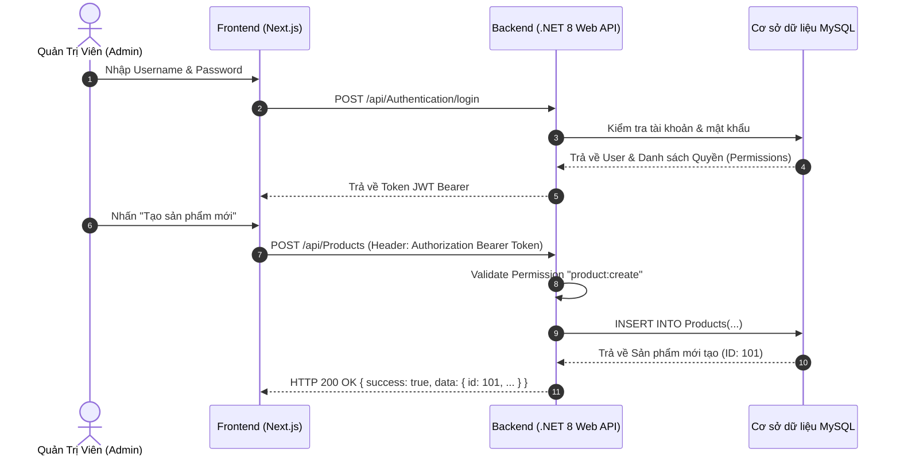
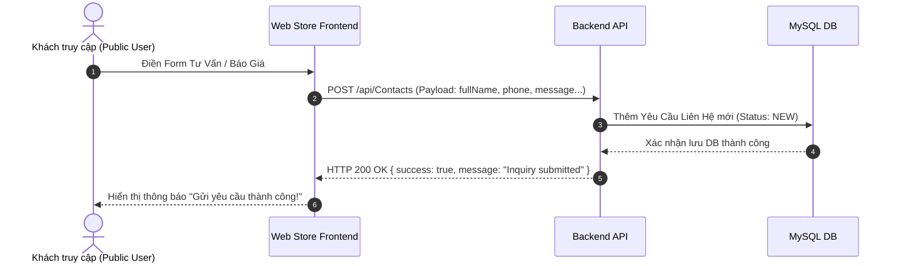

# TRANG 6: BẢNG THAM CHIẾU MÃ LỖI, SƠ ĐỒ NGHIỆP VỤ & FAQ
> **Dùng cho Notion**: Trang 6 - Reference Error Codes, Diagrams & FAQ  

---

## 1. PHẦN D – BẢNG MÃ LỖI TOÀN HỆ THỐNG

| HTTP Status Code | Error Code | Thông điệp tiếng Anh | Nguyên nhân thường gặp | Cách xử lý |
| :--- | :--- | :--- | :--- | :--- |
| **400 Bad Request** | `INVALID_PAYLOAD` | Invalid request data | Dữ liệu gửi lên sai kiểu, thiếu các trường bắt buộc (`required`). | Kiểm tra lại định dạng JSON request theo tài liệu API. |
| **401 Unauthorized** | `AUTH_TOKEN_EXPIRED` | Token is missing or expired | Không truyền Header `Authorization` hoặc Token JWT đã hết hạn. | Thực hiện gọi API `refresh-token` hoặc đăng nhập lại. |
| **403 Forbidden** | `PERMISSION_DENIED` | Access denied | Tài khoản không có đủ quyền (`RequirePermission`). | Kiểm tra vai trò của tài khoản trong phân quyền admin. |
| **404 Not Found** | `RESOURCE_NOT_FOUND` | Item or Slug not found | ID/Slug sản phẩm hoặc danh mục không tồn tại trong cơ sở dữ liệu. | Kiểm tra lại tham số đường dẫn ID/Slug. |
| **500 Internal Error** | `SERVER_EXCEPTION` | Internal server error | Lỗi phát sinh từ server chưa được bắt ngoại lệ. | Báo bộ phận Backend kiểm tra xem nhật ký lỗi tại `/api/Logs/errors`. |

---

## 2. DANH MỤC ENUMS & MÃ TRẠNG THÁI

### 2.1 Trạng thái sản phẩm / danh mục / bài viết (`status`)
- `ACTIVE`: Hoạt động / Hiển thị trên giao diện người dùng.
- `INACTIVE`: Tạm ngưng / Ẩn khỏi hệ thống.
- `DRAFT`: Bản nháp (Đang biên soạn).

### 2.2 Phân loại Danh mục (`type`)
- `PRODUCT`: Danh mục dành cho Sản phẩm thiết bị cơ khí.
- `SERVICE`: Danh mục dành cho Các dịch vụ kỹ thuật.
- `PARTNER`: Danh mục dành cho Phân khu vực Đối tác/Đại lý.

---

## 3. SƠ ĐỒ LUỒNG NGHIỆP VỤ (MERMAID DIAGRAM)

### 3.1 Luồng Đăng nhập & Tạo sản phẩm (Admin Flow)

### 3.2 Luồng Khách hàng Gửi yêu cầu tư vấn (Contact Inquiry Flow)

---

## 4. FAQ & HỖ TRỢ KỸ THUẬT

1. **Hỏi**: Làm cách nào để hiển thị danh mục theo hình cây 3 cấp?
   - **Đáp**: Gọi API `GET /api/Categories?type=PRODUCT`, dữ liệu trả về đã có thông tin `category_id` và `parent_id`. Frontend chỉ cần ghép danh mục theo quan hệ cha - con.
2. **Hỏi**: Hình ảnh sau khi upload có cần thêm domain prefix không?
   - **Đáp**: API `/api/Files/upload` trả về cả hai đường dẫn: `data.filePath` (đường dẫn tương đối `uploads/...`) và `data.url` (đường dẫn tuyệt đối chứa domain server đầy đủ).

---

## 5. CHECKLIST TỰ KIỂM TRA CHẤT LƯỢNG TÀI LIỆU
- [x] Đã mô tả 100% Endpoints thực tế có trong hệ thống backend.
- [x] Đã format toàn bộ JSON mẫu có nghĩa, không có dữ liệu rác.
- [x] Đã thêm Mermaid Diagrams cho luồng Đăng nhập & Yêu cầu báo giá.
- [x] Đã kiểm tra không còn mã lỗi hoặc nhãn `[CẦN BỔ SUNG]`.
